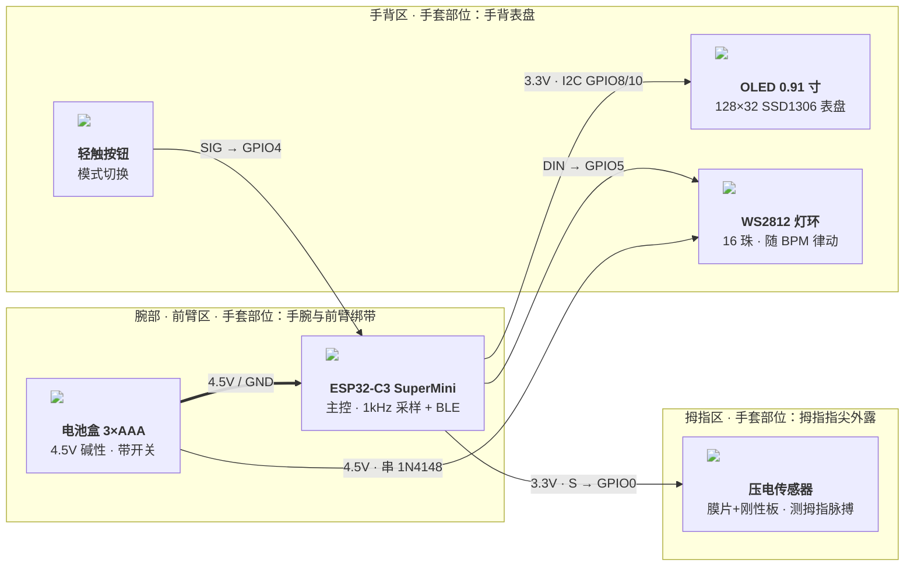

# 赛博把脉 · 可穿戴系统拓扑（ESP32-C3 脉搏检测手套）

> **渲染版**：`拓扑图.png`（由 `可穿戴系统拓扑图.html` 出图，可直接贴进课程展示）
> **可编辑源**：下面 Mermaid 代码块；`` 用相对路径引用同目录六张实拍图，本地 Markdown 预览 / mermaid.live 可见，GitHub 出于安全策略不加载外链图片（仅显示文字，属正常现象）。

## 装配铁律

1. **4.5V 只进板子 5V 脚，3.3V 从板子 3V3 引脚出**——电池盒绝不直连任何 3.3V 器件。
2. **OLED 和传感器只接 3.3V**（5V 会烧）。
3. **所有 GND 共地**；灯环电源直取电池盒并串 1N4148 隔离（图中灰虚线为 GND 一棵树，未逐根画出）。
4. **膜片两侧禁任何软垫层**；传感器引线最短并固定在绑带上。
5. **上电前用万用表核对电池盒极性**。

## 连线速查

| 从 | 到 | 标签 | 线型 |
|---|---|---|---|
| BAT | MCU | 4.5V / GND | 粗实线（主电源） |
| BAT | RING | 4.5V · 串 1N4148 | 实线 |
| MCU | SEN | 3.3V · S → GPIO0 | 实线 |
| MCU | OLED | 3.3V · I2C GPIO8 / GPIO10 | 实线 |
| MCU | RING | DIN → GPIO5 | 实线 |
| BTN | MCU | SIG → GPIO4 | 实线 |
